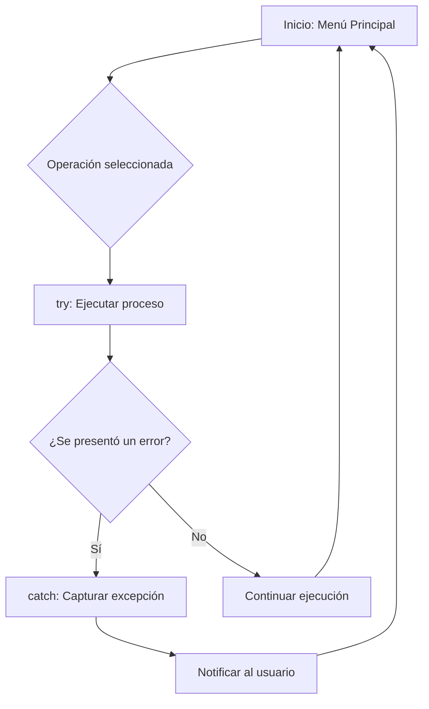
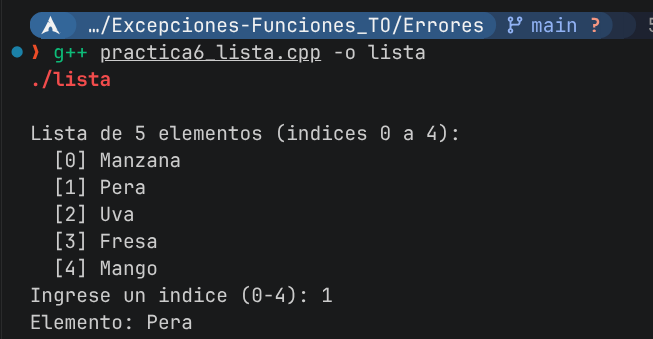
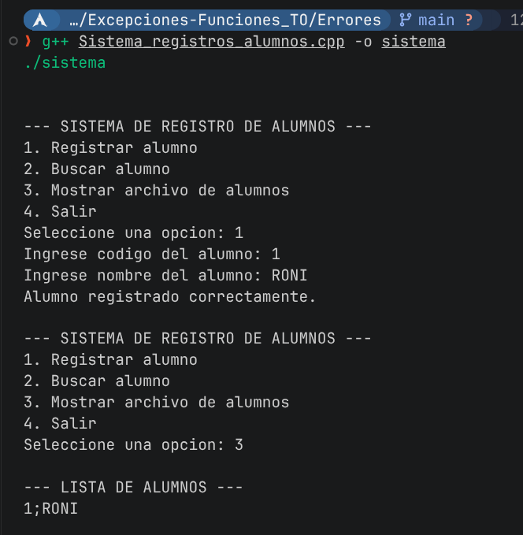

# Documentación: Manejo de Errores y Excepciones

Este proyecto integra dos ejercicios centrados en la creación de software robusto, asegurando que los programas gestionen correctamente situaciones imprevistas sin detener su ejecución.

## Ejercicio 1: Manejo de Listas y Rangos
Para este ejercicio, implementamos una lista de 5 elementos solicitando un índice al usuario. La clave aquí fue el uso de un bloque `try-catch` para capturar excepciones si el índice ingresado está fuera de los límites permitidos. En lugar de permitir un acceso a memoria inválida, programamos una validación que atrapa el error y permite al usuario reintentar, demostrando cómo proteger la integridad del programa ante entradas no válidas.

## Ejercicio 2: Sistema de Registro de Alumnos
Este mini sistema es una solución integral para la gestión de registros escolares. Para su desarrollo, utilizamos:
- **Validación de entradas:** Implementamos `cin.clear()` y `cin.ignore()` para limpiar el buffer ante entradas erróneas, evitando que el programa entre en bucles infinitos.
- **Gestión de archivos:** Utilizamos `ifstream` y `ofstream` con comprobaciones de estado (`is_open`) para manejar escenarios donde el archivo no existe o está dañado.
- **Excepciones personalizadas:** Creamos la clase `AlumnoNoEncontradoException` heredada de `std::exception`. Esto nos permitió lanzar un error específico cuando una búsqueda no tiene éxito, haciendo que el control de flujo sea mucho más limpio y semántico.

## Flujo de Control de Excepciones
El sistema utiliza una estructura centralizada que atrapa diferentes tipos de excepciones, permitiendo una recuperación controlada.



## Capturas de Ejecución
Aquí se muestran las pruebas realizadas para ambos ejercicios:

*   **Validación de índices (Lista):**
    

*   **Gestión de Registro de Alumnos:**
    

---
### Instrucciones para ejecución
Para compilar y ejecutar los programas, utiliza los siguientes comandos en tu terminal:

**Para el Registro de Alumnos:**
```bash
g++ Sistema_registros_alumnos.cpp -o sistema
./sistema
```

**Para la validación de listas:**
```bash
g++ practica6_lista.cpp -o lista
./lista
```
*(Recuerda colocar tus imágenes en esta misma carpeta y nombrarlas `ejecucion_lista.png` y `ejecucion_registros.png` para que se visualicen correctamente).*
