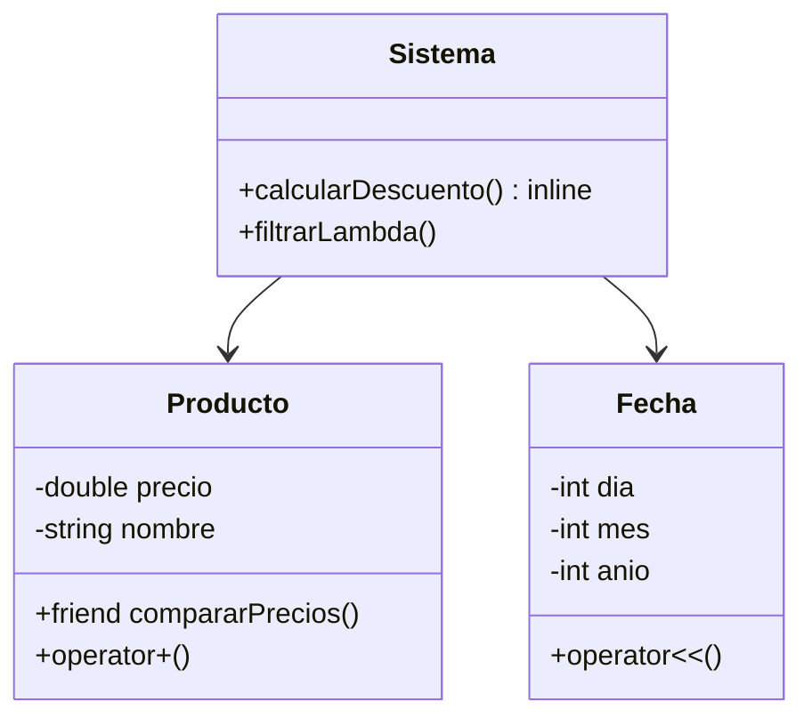
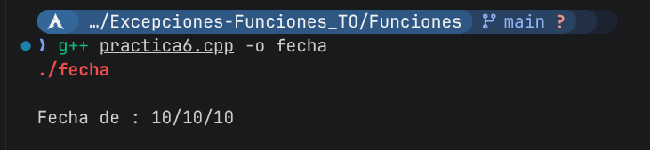
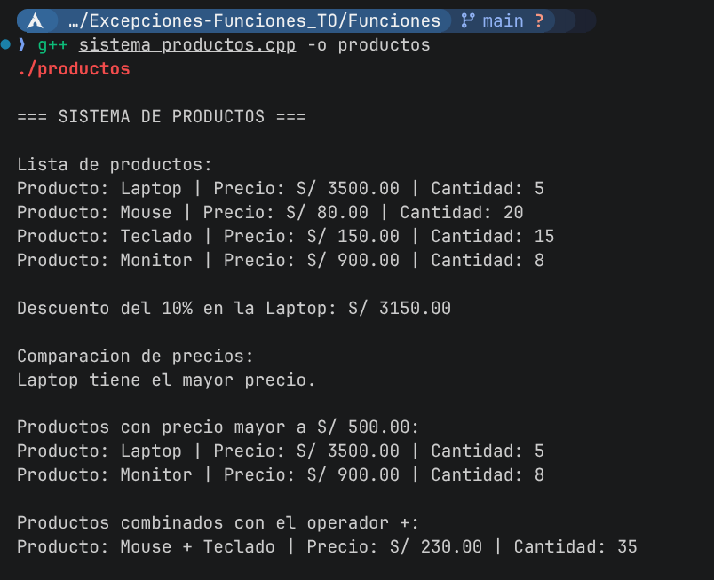

# Documentación: Funciones, Clases y Sobrecarga

Este proyecto integra dos ejercicios centrados en la programación orientada a objetos en C++, utilizando conceptos avanzados para mejorar la legibilidad y la eficiencia del desarrollo.

## Ejercicio 1: Sobrecarga del Operador << (ostream)
Desarrollamos una clase `Fecha` con atributos para día, mes y año. El núcleo de este ejercicio fue la sobrecarga del operador `<<`, permitiendo que el objeto `Fecha` se imprima directamente con un `cout << fecha`. Implementamos lógica de validación interna en el constructor para asegurar que las fechas sean siempre válidas (por ejemplo, rechazando un mes 13 o un día 32), asegurando que el estado del objeto sea siempre correcto.

## Ejercicio 2: Sistema de Productos
En este ejercicio aplicamos conceptos avanzados de POO para modelar un sistema de productos:
- **Funciones inline y const:** Usamos `inline` para optimizar el cálculo de descuentos, reduciendo el overhead de las llamadas a función, y funciones `const` para métodos de lectura, garantizando que no se modifiquen atributos accidentalmente.
- **Funciones Friend:** Implementamos una función `friend` que permite comparar precios entre dos objetos `Producto` de forma eficiente, accediendo a sus atributos privados sin violar la encapsulación.
- **Funciones Lambda:** Utilizamos expresiones lambda para filtrar una colección de productos basándonos en criterios de precio, lo que nos permitió un código más compacto.
- **Sobrecarga de operadores:** Además de `<<`, sobrecargamos el operador `+` para permitir operaciones de suma entre objetos (por ejemplo, combinar precios totales), haciendo el manejo de los productos muy intuitivo.

## Arquitectura del Sistema
El diseño combina los ejercicios para demostrar la aplicación de estos paradigmas:



## Capturas de Ejecución
Aquí se presentan las pruebas realizadas para ambos ejercicios:

*   **Sobrecarga de Fecha:**
    

*   **Sistema de Productos:**
    
---
### Instrucciones para ejecución
Para compilar y ejecutar los programas, utiliza los siguientes comandos en tu terminal:

**Para la clase Fecha:**
```bash
g++ practica6.cpp -o fecha
./fecha
```

**Para el Sistema de Productos:**
```bash
g++ sistema_productos.cpp -o productos
./productos
```
*(Recuerda colocar tus imágenes en esta misma carpeta y nombrarlas `ejecucion_fecha.png` y `ejecucion_productos.png` para que se visualicen correctamente).*
